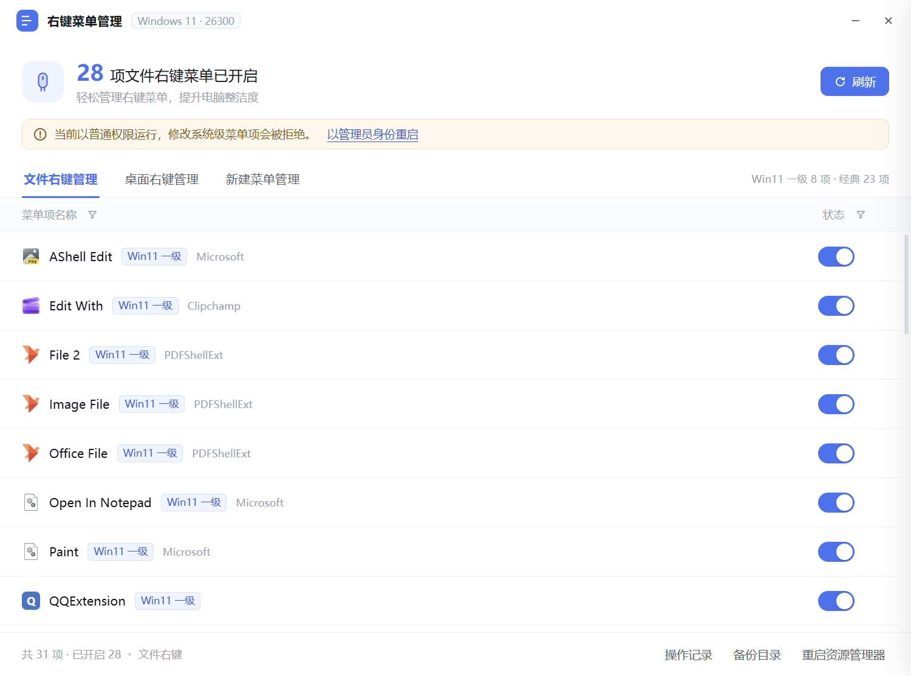

# 右键菜单管理

一个轻量的 Windows 右键菜单管理器。界面参照火绒安全的「右键管理」页面，读的是真实注册表，开关也真实生效。



## 特性

- **三个页面**：文件右键、桌面右键、新建菜单
- **真读真写**：扫描 `HKCR` 下的 shell 动词、COM 扩展处理器、`ShellNew` 项，开关立即写入注册表
- **Win11 / Win10 双菜单识别**：区分「Win11 一级菜单」和「Win10 经典菜单」，可按类型筛选
- **可逆，不删键**：关闭菜单项只写隐藏标记，随时可以开回来
- **详情抽屉**：点任意一行查看注册表路径、CLSID、关联 DLL/EXE，一键打开注册表或文件位置
- **免安装单文件 exe**，也支持源码运行

## 下载使用

从 [Releases](../../releases) 下载 `右键菜单管理-x.x.x.exe`，双击即用，不需要安装 Node。

- 未做代码签名，Windows SmartScreen 可能拦截：点「更多信息 → 仍要运行」
- 便携版每次启动会自解压到 `%TEMP%`，首次约 3–5 秒出窗口
- 修改系统级菜单项需要管理员权限，点界面上的「以管理员身份重启」

从源码运行：

```bash
npm install
npm start
```

## 三个页面管什么

| 页面 | 管什么 | 数据来源 |
|---|---|---|
| 文件右键管理 | 右键文件时出现的菜单 | `HKCR\*\shell`、`HKCR\*\shellex\ContextMenuHandlers`、`HKCR\AllFilesystemObjects\...` |
| 桌面右键管理 | 右键桌面空白处的菜单 | `HKCR\Directory\Background\shell` + `shellex`、`HKCR\DesktopBackground` |
| 新建菜单管理 | 右键 → 新建 的二级菜单 | 各扩展名的 `HKCR\.ext\ShellNew` |

### Win11 一级菜单 vs Win10 经典菜单

Windows 11 有两套右键菜单。新的紧凑菜单只显示带包标识、实现了 `IExplorerCommand` 的项（在应用清单
`windows.fileExplorerContextMenus` 里声明），所有传统 `shellex` 处理器都被折叠进「显示更多选项」。

本工具的判定方式是查该 CLSID 是否属于声明了右键菜单的打包应用，**这是推断，不是百分之百准确**。
同理，打包应用（画图、记事本、WPS 等）的菜单标题由程序运行时提供，拿不到就只能用动词 ID 加包名标注，
所以会看到 `File 1`、`AShell Edit` 这类名字。

## 安全设计

关闭菜单项 = **隐藏，不删除**：

| 项目类型 | 关闭时做什么 | 开启时做什么 |
|---|---|---|
| Shell 动词 | 写入 `LegacyDisable` 值 | 删掉该值 |
| Shell 扩展 / 打包项 | CLSID 写入 `Shell Extensions\Blocked` | 从 Blocked 移除 |
| 新建菜单（ShellNew） | 快照备份后移除该项 | 从备份还原 |

`ShellNew` 是唯一的例外：系统没有为它提供任何隐藏开关，所以只能先备份再移除。
备份（JSON 快照）存放在 `%APPDATA%\右键菜单管理\data\backups`，界面上会先弹确认框说明这一点。

另外，改动菜单项后资源管理器有缓存，需要用界面右下角的「重启资源管理器」刷新才能看到效果。

## 构建

```bash
npm install
npm run icon     # 生成 assets/icon.ico（六个尺寸，纯 Node 绘制，无图形库依赖）
npm run build    # 输出 dist/右键菜单管理-x.x.x.exe
```

打包时 `asar` 是关闭的：`scan.ps1` / `regwrite.ps1` 必须是磁盘上真实存在的文件，
PowerShell 才能执行，asar 包内的路径 spawn 不了。

## 自测

```bash
npm run selftest   # 10 项写入 / 备份 / 还原检查，只动 HKCU 下的临时键
npm run e2e        # 建一个真实菜单项 → 关闭 → 读回 → 开启 → 删除
```

## 目录结构

```
src/main.js            Electron 主进程：窗口、IPC、图标提取
src/preload.js         contextBridge 暴露的 API
src/registry.js        扫描、开关、备份、重启资源管理器
src/store.js           状态与备份目录（%APPDATA%）
src/renderer/          界面（原生 ES 模块，无构建步骤）
scripts/scan.ps1       注册表枚举，输出 JSON
scripts/regwrite.ps1   注册表写入（.NET API，不依赖 reg.exe）
scripts/make-icon.js   纯 Node 绘制并编码 PNG / ICO
scripts/selftest.js    写入路径自测
scripts/e2e.js         端到端往返测试
```

## 排查

启动时设置 `CTXMENU_DEBUG=1`，会在 `%TEMP%\ctxmenu-boot.log` 留下启动轨迹
（窗口是否创建、页面是否加载、渲染进程报了什么错）。

如果程序一启动就退出且没有任何窗口，检查环境里是否设置了 `ELECTRON_RUN_AS_NODE=1` ——
这个变量会让 Electron 退化成纯 Node 直接退出。

## 已知限制

1. Win11 一级 / 经典的判定是启发式的，可能误标
2. 打包应用的菜单标题拿不到，只能用动词 ID 加包名代替
3. 部分系统内置动词（`pintohomefile`、`removeproperties` 等）只在特定上下文出现，列表里能看到属于正常现象
4. 只处理注册表来源的菜单项，不处理 MSIX 应用自己动态生成的深层菜单

## License

[MIT](LICENSE)

界面布局参考了火绒安全「右键管理」页面的信息结构，配色与实现均为独立完成，未使用其任何资源。
